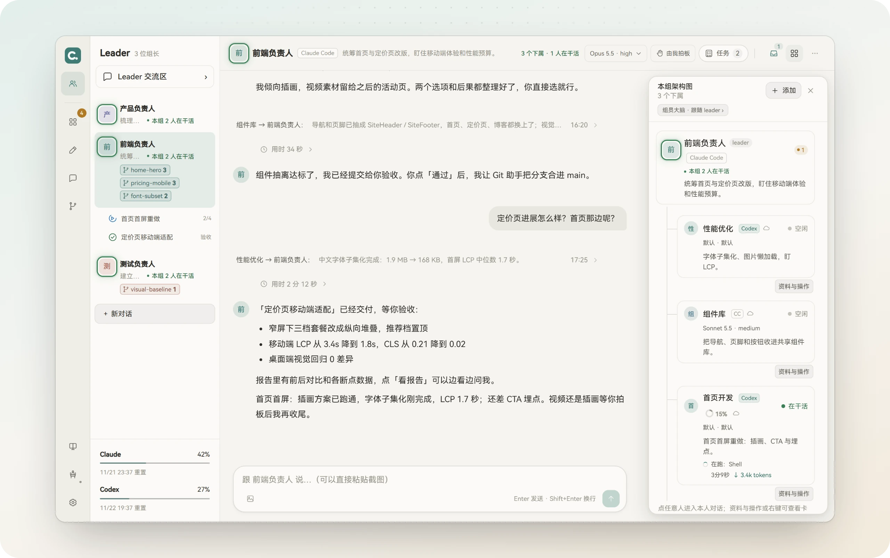
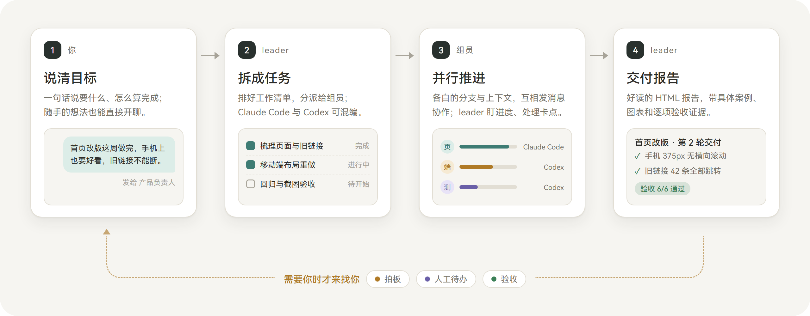
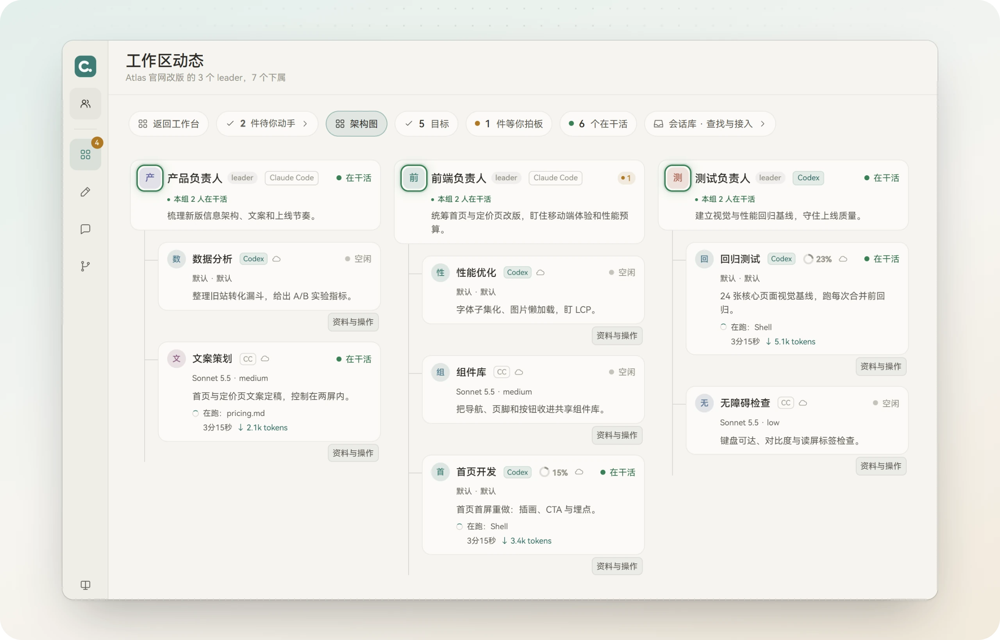
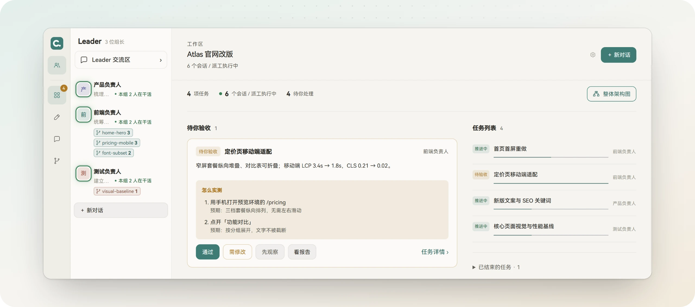
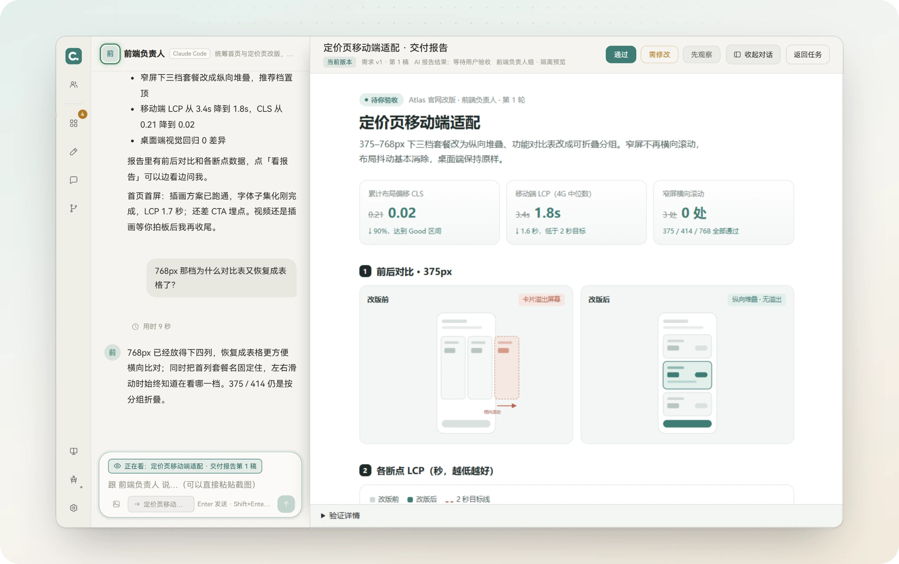
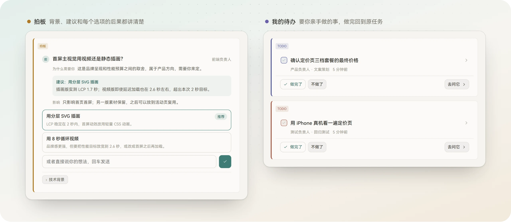
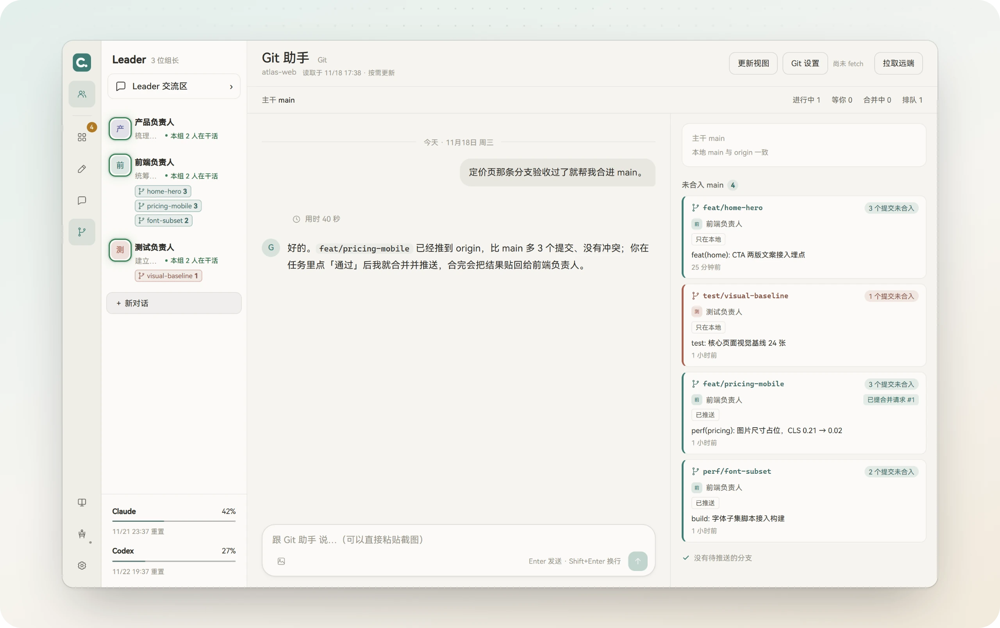
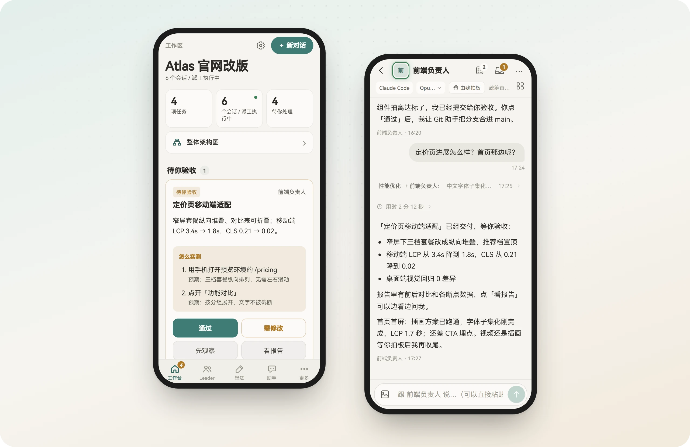

<picture>
  <source media="(prefers-color-scheme: dark)" srcset="docs/readme/hero-dark.webp">
  
</picture>

<p align="center">
  <a href="https://github.com/akitokunnn/Crew/releases/latest"></a>
  
  
  
</p>

<p align="center">
  <b>Crew</b> 把 Claude Code 和 Codex 组织成一支有 leader、有组员的团队，在你的项目文件夹里并行干活。<br>
  你负责说目标、拍板和验收，其余交给它们。
</p>

<p align="center">
  <a href="https://github.com/akitokunnn/Crew/releases/latest"><b>下载 Windows 版</b></a>
  &nbsp;·&nbsp; <a href="#快速开始">快速开始</a>
  &nbsp;·&nbsp; <a href="#工作方式">工作方式</a>
  &nbsp;·&nbsp; <a href="docs/GUIDE.md">使用手册</a>
</p>

<br>

<picture>
  <source media="(prefers-color-scheme: dark)" srcset="docs/readme/shot-workspace-dark.webp">
  
</picture>

## 工作方式

<picture>
  <source media="(prefers-color-scheme: dark)" srcset="docs/readme/flow-dark.webp">
  
</picture>

一个工作区就是一个项目文件夹（普通文件夹即可，不需要 Git）。你和 leader 对话，leader 决定怎么拆、交给谁、用哪种 AI，组员在各自的上下文里并行执行。每个任务独立推进、独立保存历史，启动新任务不会打断其他任务。

## 亮点

### 一个 leader，一组组员

leader 自主分配、协调多个任务，负责验收和最终交付，必要时自己动手。Claude Code 与 Codex 可以混编在同一组，VS Code 里已有的 Claude 会话也能收编进来。整体架构图里每位 leader 一列，谁在干活、在跑什么、用了多少 token 一目了然；模型与思考强度读取本机实际清单，每组、每人都能单独设置。



### 打开项目，先看到要你处理的事

工作区主页把待你验收、等你拍板、人工待办和进行中的任务排在一起。待验收的任务附上“怎么实测”的步骤，直接点“通过 / 需修改 / 先观察”。



### 交付是一份好读的报告

每轮交付是 leader 写的自包含 HTML 页面：具体案例、图表、逐项验收证据。报告在对话旁打开，**边看边聊**：宽屏左右并排、可拖动调宽，输入框标出“正在看”，选中报告里的文字可一键引用。



### 只在需要你时打扰

需要你定方向时，leader 先把背景、建议和每个选项的后果讲清楚再请你**拍板**；要你亲手做的事进入**我的待办**，做完会回到提出它的任务。每个任务可以单独选择“由我拍板”或“自主推进”。



### Git 交给 Git 管理员

Git 页列出还没合入主干的分支，每条标出负责的 leader、是否已推送、差几个提交、有没有提合并请求。一个任务只用一个分支；提交交给 Git 管理员按规则合并，确实要等合入后继续的工作才会被唤醒。



### 手机上也能管

开启“局域网访问”后，同一网络（或 ZeroTier）里的手机用一次性配对码登录，就能聊天、拍板、处理待办、看报告。设备可以单独撤销，关闭访问不影响电脑上正在跑的任务。



## 还能做什么

| | |
|---|---|
| **重启自动续跑**<br>Crew 重开后，托管的 CC / Codex 会接回关停时还在执行的任务和对话。载体意外退出也会自动续接，最多重试三次。 | **空闲回收**<br>空闲 30 分钟自动关掉托管进程，下次输入按原会话接回，不丢上下文。 |
| **动态上下文**<br>只装载当前目标相关的材料，来源可查、可纠正；原生历史超限时自动换代。 | **行为配置**<br>Crew 发给 AI 的每一份指令都能在设置里查看，并按全局、工作区或单个会话覆盖。 |
| **用量分析**<br>按组、会话、日期和模型汇总 Claude / Codex token，按价格表折算参考金额。 | **守卫**<br>黑名单、文件归属、设备借用与 Git 规则，Claude 用插件 hooks，Codex 用原生执行前 hook。 |
| **原生权限审批**<br>Codex 要越过沙箱执行命令时，页面显示命令、目录和原因，由你允许或拒绝。 | **远程提醒**<br>QQ / Lark 私聊由全局助手处理：答复提醒、登记拍板、整理待办。 |
| **技能面板**<br>在输入框打 <code>/</code> 选技能，比如把测过的内容一次合进主干并推送的 git-land。 | **存储与清理**<br>按类别查看占用，先预览再清理；旧备份先进 7 天回收站，可恢复。 |

完整功能与操作见 [使用手册](docs/GUIDE.md)。

## 快速开始

**准备**：Windows x64；Python 3.11 以上（命令行能运行 `python`）；至少一个已安装并登录的 [Claude Code](https://github.com/anthropics/claude-code) 或 [Codex CLI](https://github.com/openai/codex)。只有分支、提交、合并等 Git 功能才需要 Git。

1. 从 [Releases](https://github.com/akitokunnn/Crew/releases/latest) 下载 `Crew-<版本>-setup.exe` 安装；也可以用免安装的 `win-x64.zip` 或单文件 `portable.exe`。
2. 打开 Crew，选择一个项目文件夹，或新建一个空工作区。
3. 点“起 leader”，选执行工具和模型，说出目标。

关闭窗口会隐藏到托盘，后台任务继续跑；从托盘选“退出 Crew”才会真正退出。数据保存在 `~/.crew`，升级不需要重新建工作区，细节见 [桌面更新](docs/DESKTOP_UPDATES.md)。

<details>
<summary><b>从源码运行</b></summary>

还需要 Node.js / npm。

```powershell
git clone https://github.com/akitokunnn/Crew.git C:\Tools\Crew
cd C:\Tools\Crew\desktop
$env:ELECTRON_CACHE = Join-Path (Get-Location) '.cache/electron'
$env:ELECTRON_BUILDER_CACHE = Join-Path (Get-Location) '.cache/electron-builder'
npm install
npm start
```

`npm run build` 按 `desktop/package.json` 的版本生成安装版、便携版和 ZIP，构建与隔离验收见 [桌面版说明](desktop/README.md)。命令行 `crew`、浏览器访问、右键“在这里启动 Crew”和 Claude 插件的安装方式见 [使用手册](docs/GUIDE.md#安装与启动)。

</details>

## 文档

| | |
|---|---|
| [使用手册](docs/GUIDE.md) | 全部功能、日常操作与命令速查 |
| [工作流程](docs/WORKFLOWS.md) | leader、组员、任务、拍板与交付怎么配合 |
| [页面说明](docs/WEB_UX.md) | 每个页面和入口的用途 |
| [桌面更新](docs/DESKTOP_UPDATES.md) | 下载包选择、升级与发布流程 |
| [Codex 接入](docs/CODEX_INTEGRATION.md) | Codex 的原生接入与守卫边界 |
| [局域网访问](docs/v2/LAN_ACCESS_0.3.4_2026-11-01.md) | 手机访问、配对与设备管理 |
| [设计说明](docs/DESIGN.md) | 架构、数据与模块划分 |
| [产品演进](docs/PRODUCT_EVOLUTION.md) | 产品方向与迭代取舍 |

## 参与开发

开发者和 AI 请先读 [AGENTS.md](AGENTS.md)：分支约定、本地试用与推送流程、验证要求都在里面。当前检出的桌面版本以 `desktop/package.json` 为准。

<br>

<p align="center">
  
  <br>
  <sub>Crew · 为同时带着很多 AI 干活的人而做</sub>
</p>
