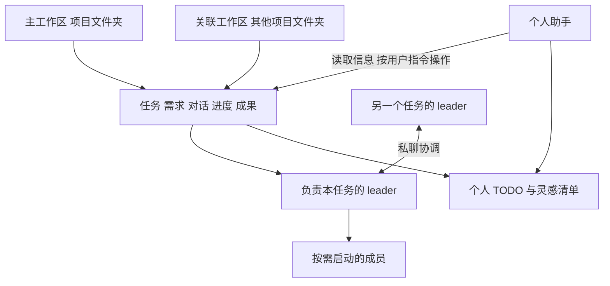

# Crew 产品改造需求草案

2026-10-28 · 用户与 Codex

Crew 面向个人 vibe coding，把需求对话、持续执行、人工拍板、个人 TODO 和成果放进同一套可从电脑与手机访问的工作流程。

本次对话已经确认产品原则和主要操作。整体布局与动画方案待 Codex 和 Claude 结合现有 Crew 共同评审，再由用户实际体验拍板。以下是待实施目标，不代表已发布功能。

## 目标与产品结构

用户描述需求后，AI 应主动澄清真正影响实现的问题，逐步形成任务核心。需求明确时直接推进；实现路线不明确时，通过有目的的实验找办法。

核心目标：

- 连续推进明确的任务，支持过夜工作，并保留可恢复的进度。
- 每个任务独立选择用户把关或 AI 全自动决定。
- 将确实需要用户动手的事情汇总为个人 TODO。
- 快速保存灵感，并能接着讨论、推进。
- 给具体施工成员提供相关、干净的上下文，减少重复输入和模型唤醒。
- 电脑与手机都能对话、拍板、控制任务、查看进度和成果。
- 保留 CC 和 Codex 的原生技能、工具及执行能力。
- 复用已经通过的相关验证；出现新改动、失败或证据时，再验证受影响部分。

工作区对应项目文件夹，普通文件夹也可以使用。项目归属是独立字段，AI 标签用于理解和筛选。

一个任务有主工作区，可以关联其他工作区，由一个 leader 对整体结果负责。任务保留需求、约定、拍板、实验结论、进展、成果和历史，载体切换不改变任务归属。

## 完整使用流程

以“落地声纹”为例：

1. 用户选工作区后直接开始对话，形成任务记录。AI 自动取标题，随着讨论提炼任务核心；用户可以修改标题和归属。
2. AI 澄清使用场景和重要条件，例如速度、准确度、本地或联网要求。普通解释与讨论直接聊天。
3. 任务详情维护当前目标、条件、完成标准和已确定的取舍。AI 随讨论更新，用户可以从任务入口查看和直接修改。
4. 用户通过自然语言下达执行要求。leader 优先自己推进，确有必要才拆出具体工作给成员。
5. 发现模型慢或不准确时，AI 可以针对原目标主动实验和优化，记录问题、结果和下一步。
6. 执行中收到用户消息时，应尽快交给当前对话的 AI。调整指令用于当前工作，询问得到回应，明确要求稍后的内容排队处理；提供明确的排队发送选项。
7. 需要用户拍板的内容在原任务对话里解释、讨论。可以一次沟通多个问题，再统一拍板。与拍板无关的可执行部分继续推进。
8. 出现可体验的阶段成果时，在任务卡上提示，并明确成果版本号。用户打开程序、文档或网页体验，再在原任务反馈。
9. 报告随实质进展更新。过夜执行不会因为天亮、到了汇报时间或生成了报告就自行终止。
10. 满足约定标准后交付。工程成果可由 AI 按标准判断；需要用户体验的部分进入待体验状态。后续反馈仍在原任务继续，保留过去的成果与报告。

新框架搭建、审美和交互需要通过可运行的小版本逐步体验。用户在把关模式下理解流程、作出决定，再继续下一段实现。

## 权责与执行规则

全自动决定是任务级开关，授权范围是本次工作。成员继承本任务模式，换 leader 或载体时继续保留。

| 项目 | 已确认规则 |
| --- | --- |
| 用户把关模式 | 新框架形成、审美、实际交互体验和重要效果取舍由用户拍板。改变已定条件或新增显著范围时说明影响 |
| 全自动模式 | AI 在本任务范围内决定路线、实验与取舍，持续推进并记录结论 |
| 原生执行权限 | 在设置中配置 CC 和 Codex 的访问权限；用户选择完全访问。执行权限与任务决策模式分开 |
| leader 默认 | 优先 CC 与 Opus，允许用户修改 |
| 施工成员默认 | 优先 Codex，由 leader 根据任务难度选择实际合适的模型和 effort |
| 简单工作 | leader 可以选 Sonnet、Terra 等用户允许且实际可用的模型。名称是偏好示例，模型清单与能力来自原生发现和用户配置 |
| 载体故障切换 | 允许在具备所需能力时换用另一载体，保留任务、约定和成果并记录原因；遵守本任务的明确载体限制 |

用户可以直接与任何成员对话。会影响整体任务的指令同步给 leader，保留原始输入。成员界面顶部提供可点击的“任务 → leader → 成员”来历。

leader 之间可以私聊，协调文件、接口和依赖。沟通可回溯，影响任务的结论落入任务记录；内部交流按需要展开查看。

不同工作区、不同任务的 AI 同时运行。置顶和显示排序可以保留，执行不依赖跨项目优先级队列。同工作区的 AI 自己协调修改，复用当前工作区进行整体编译和体验；不能覆盖其他 AI 尚未交付的修改。

保留原生子代理能力。Crew 的任务组织复用已有 leader 和成员机制，按需派活。dispatch 只提取清晰任务说明、精简上下文和交付依据等提示词规则，当前不另建共享派工服务。

日常 Git 收尾由任务 leader 负责，同工作区协调批量交付。用户偏好多个普通改动集中在工作区体验；提交与合并遵循对应仓库规则。独立 Git 管理 AI 不作为必经环节，现有 Git 查看与相关数据保留。

公共频道保留为可选交流入口，摘要按需生成。后续有人格的助手和成员可以在这里聊天；人格与主动聊天规则以后设计。

保活、重连和基础恢复由程序负责。需要分析系统故障时再按需启动运维 AI，个人助手与运维职责分开。

## 日常入口与手机操作

电脑端支持桌面壳和网页，提供完整 Crew 操作。产品围绕对话、说明文档、成果和快速打开文件夹组织，代码编辑继续使用熟悉的工具。

手机网页提供轻量入口：发消息、补充要求、查看进度、拍板、处理 TODO、控制任务，以及打开报告、格式化文档和网页。桌面程序在 PC 上运行和体验。

输入支持文字、截图、图片和文件。用户不使用语音输入，本轮不安排语音功能。

首页集中呈现待用户处理的简短摘要、工作区进展和快速记录入口。首页的待拍板项只跳转原任务；细节沟通与统一拍板留在原对话。

任务详情按需从任务进入，AI 维护，用户也可以修改。成员卡点击进入该成员对话。整体排版留给后续布局评审，不把曾讨论的三栏方案当作已拍板布局。

### 个人 TODO 与灵感

个人事项放在一张清单中，支持 AI 标签、工作区归属和筛选。全局可以查看所有项目，工作区内默认显示本项目。未知归属可以暂未分配。

快速输入明确区分“记下来”和“开始聊”。记下来先保存原话与归属、标签；开始聊进入相关工作区的对话，可以接已有任务。灵感成为任务后由任务标题和关联承接，不另做一套转化状态。

| 情况 | 已确认行为 |
| --- | --- |
| 任务需要用户亲自操作 | AI 直接创建 TODO，附简短原因和原任务入口 |
| 相同操作被多个任务需要 | 合并成一条 TODO，保留各任务关联，完成后通知相关任务 |
| TODO 新增 | Crew 通过启用的 QQ 和 Lark 渠道同步通知，页面与通知引用同一事项 |
| 用户完成操作 | 可勾选并补说明或图片，也可以在原对话说明完成；仍在推进的关联任务继续执行 |
| 用户做不了或不想做 | 说明原因后交回 leader，寻找替代办法；重要取舍沿用任务模式 |
| 每日安排 | 用户与个人助手聊天整理，不专门开发“今天建议”排程界面 |

机器人主要承担提醒和回到对应任务的入口。复用已有渠道连接与可用交互，普通实验进展留在任务和报告中。

### 基础个人助手

这一版提供固定的个人助手聊天入口，能够读取 Crew 的项目、任务、TODO 和成果，帮助整理日常事项。先使用基础提示词，提示词、人格深化和长期记忆架构可继续演进。

用户明确吩咐时，助手可以新开任务、向相关 leader 传达要求、查询进度、停止指定任务，以及修改被明确指定的设置或提示词。临时要求记录在任务里；明确要求以后都这样时，修改对应长期配置并说明作用范围。

助手可以整理、归档和将记录放进垃圾箱，永久清空由用户手动操作。用户随口讨论的想法先讨论，开始执行与记下的意图应清楚。

基础提示词草案：

> 你是 Crew 的个人助手，帮助用户了解各项目进展、整理 TODO 和灵感、找到相关任务与成果。需要信息时，先读取 Crew 中的相关记录，减少让用户重复说明。日常直接沟通，给出具体建议和下一步。保留用户原意，明确区分已经确定的事情和你的建议。收到明确操作指令时，使用 Crew 能力完成，说明结果和影响范围。

## 成果报告与版本恢复

每个实际执行并交付成果的任务维护一份持续更新的报告。出现新的结论、实验结果、重要取舍或可体验成果时更新相关部分，普通问答直接在对话里回答。

报告与执行终止分开。写完报告不会自动结束尚未完成的任务，也不为每次进度变化重写整篇报告。用户可以随时查看当前结果和保留的历史交付。

有新成果的任务卡需要清楚、有设计感的视觉提示。用户正在阅读报告时，更新应保留阅读位置；具体提示和动画在原型里体验。

报告写作采用用户提供的 anthropic-skills:docs 风格：

- 第一段直接给结论、结果或当前状态，篇幅贴合实际内容。
- 按节逐步呈现；需要研究的部分先放说明用途的 pending 占位，可看的内容及时打开。
- 对比与多属性条目用表格，有分支的流程和结构用图示，趋势与构成数据按形状选图。
- 同一组数字采用图或表的一种表达，不重复铺陈。
- 图表以灰色和一个强调色为主，文字清楚，深浅主题可读。
- 引用外部事实时实际打开来源，附链接和截至日期；不编造数字或效果。
- 用户修改过的内容要保留；更新发生冲突时以用户修改为准。

Crew 需要把这些写作与呈现规则映射到自己的文档能力。Claude 文档工具的 widget、版本参数和专用接口，需要对应实现，不能仅靠复制提示词获得。

说明文档、Markdown、报告和图片可在 Crew 内打开；网页提供打开链接，本地成果提供启动或运行方式，文件夹提供快速打开入口。

每次明确的阶段交付说清版本号，并将版本与实际成果或代码记录关联。应用的真实版本与发布状态按项目实际依据确认。

用户可以说“恢复到某版本”。AI 按明确目标和实际修改记录恢复对应效果，协调保留其他并行任务的改动。版本恢复适用于项目文件，普通文件夹不因此被强制初始化成 Git 仓库。

## 设置与原生能力

设置提供全局默认、工作区覆盖和单个 AI 配置。每项显示实际值、继承来源和生效范围；用户通常只需要配置全局默认。

保存后新会话使用新设置。已有会话保留当前配置，用户可以主动应用修改，界面明确生效时机，执行保持连续。

| 范围 | 设置要求 |
| --- | --- |
| AI 配置 | 按角色设置载体、模型和 effort，leader 可据此为具体工作选择成员配置 |
| 通用工作原则提示词 | 可查看、修改推进方式、沟通风格、实验与验证习惯 |
| leader 和成员提示词 | 可分别查看、修改理解需求、协作、施工和交付规则 |
| 个人助手提示词 | 可查看、修改日常整理和交流方式 |
| 报告提示词 | 可查看、修改文风、结构、图表和更新方式 |
| 摘要与上下文提示词 | 可查看、修改频道整理、上下文压缩、记忆装载和交接规则 |
| 执行权限 | 配置 CC 和 Codex 的实际访问范围；任务全自动决定开关仍位于任务上 |
| 连接与本机能力 | 复用 QQ、Lark、工具检测、后台与数据位置、外观等现有链路 |

Crew 自己注入的行为提示词必须能查看和修改，提供恢复默认、修改历史，以及查看某个 AI 实际使用内容的能力。用户希望保持充分可塑性。

用户可以通过自然语言要求助手或相关 AI 修改指定的长期设置。修改完成后说明改了什么、作用于哪里，不把任务中的临时要求偷偷改成全局规则。

CC 和 Codex 的 Skill、MCP 与项目说明等能力先沿用各自原生配置。Crew 展示实际加载内容及其来源，PC 上可以快速打开原配置。原生配置的完整可视化编辑器不作为本轮要求。

提示词和原生能力应按实际载体装载，模型与 effort 使用原生发现及用户选择。Crew 会话能否在官方客户端继续同一原生对话，另行验证兼容性。

项目的运行、构建、验证方式由每个任务的 leader 读取说明文件、识别并维护，留在任务上下文中。设置页不新增一套要求用户填写这些命令的表单。

## 故障停止恢复与垃圾箱

CC、Codex 和 Crew 数据先放在用户可保持开机联网的电脑上。后台独立常驻，桌面端和网页是操作前端；退出桌面窗口不停止后台任务。其他设备通过网页连接，主机离线时暂时无法使用可以接受。

云数据库不是首版前提。远程接入可研究 Cloudflare 等方案，具体连接配置随部署方案确定。

### 少量恢复尝试与程序通知

遇到模型调用、执行或构建故障时，只做少量、有依据的恢复尝试。达到上限仍无法推进，就停止受阻执行，保留真实原因和已尝试的方式。

Crew 程序直接向启用的 QQ 和 Lark 发送任务、问题摘要和跳转入口，发送提醒不依赖再次调用 AI。其他独立任务照常推进。

故障恢复次数需要程序约束，具体小次数默认值在实现方案中确定。有目标的效果优化实验沿用任务推进规则，同一故障的重复恢复受上限约束。已经成功的操作和成果不因后续失败被自动重做。

### 停止与恢复

| 操作或事件 | 结果 |
| --- | --- |
| 对话中的停止 | 仅停止当前对话 AI，其他 AI 继续 |
| 任务停止 | 停止本任务及其成员、关联派发与执行 |
| 停止后已有代码与成果 | 留在工作区，需要撤回时由用户另行指定目标版本 |
| 后台或主机恢复 | 自动接续原本正在执行的工作，复用已完成结果；手动停止的工作保持停止 |
| 用户完成人工 TODO | 通知相关任务继续；手动停止状态不会被这一事件覆盖 |
| 载体切换 | 继续原任务，保留需求、拍板、成果和下一步 |

### 历史与垃圾箱

完成或归档的内容保留为历史。删除进入可恢复的垃圾箱，运行中任务先停止其执行及成员。代码、项目目录和成果文件保留。

恢复先还原记录，用户明确继续后才恢复执行。工作区移除也保留项目文件夹，复用现有可恢复移除能力。

永久清空由用户手动操作，针对 Crew 中选择清空的记录。个人助手可以整理、归档和移入垃圾箱，不能代替用户永久清空。

本轮不新增统一全文搜索界面；已有局部查找可保留。AI 按需检索和读取相关历史的上下文机制继续保留，已移入垃圾箱的记录不作为正常活动上下文装载。

## 实施边界与布局评审

### 审美与交互要求

用户喜欢优雅、有设计感、有交互动画的软件。页面切换、面板展开、任务状态变化和新成果提示，应作为整体交互设计的一部分。手机保持轻量，PC 提供完整体验。

Codex 是主要交互参照。Cursor 的多 AI 布局、Linear 的事项与通知导航、Craft 的文档阅读可作为补充参考：

- [Cursor 多 AI 平铺与面板交互](https://cursor.com/changelog/3-1)
- [Linear Inbox 与事项导航](https://linear.app/docs/inbox)
- [Craft 文档与任务体验](https://www.craft.do/)
- [OpenAI 对 Steer 和 Side chat 的说明](https://developers.openai.com/blog/mastering-codex-remote-for-engineering)

来源已于 2026-10-28 打开核对。公开说明区分中途调整方向与旁支问答；用户观察到的快速中途回复，具体是否换用模型仍需核实，不能据此决定 Crew 的底层机制。

整体布局由 Codex 和 Claude 结合本次需求与现有 Crew 讨论。讨论应产出具体页面结构、操作路径和动画反馈建议，再通过可运行的小版本让用户体验。既有自定义交互是设计基线。

### 复用已有产品

先找现有工作区、leader 与成员、目标、对话、文档、TODO、拍板、QQ 和 Lark、置顶、Git、用量和设置的实际链路，再制定迭代方案。未在示意中画出的旧功能不视为删除。

主要入口包括：

- [目标与交付](../plugin/crew/goals.py)、[目标运行](../plugin/crew/goal_runtime.py)、[动态上下文](../plugin/crew/goal_context.py)。
- [对话管理](../plugin/crew/chat.py)、[CC 启动](../plugin/crew/spawn.py)、[Codex 运行](../plugin/crew/codex_runtime.py)。
- [网页入口](../plugin/crew/web.py)、[网页界面](../plugin/crew/web/)、[桌面入口](../desktop/src/main.cjs)。
- [AI 设置](../plugin/crew/settings.py)、[设置界面](../plugin/crew/web/settings-ui.js)、[通知](../plugin/crew/notifications.py)。
- [工作区设置](../plugin/crew/workspace_settings.py)、[会话整理](../plugin/crew/session_ops.py)、[存储入口](../plugin/crew/store.py)。

[既有设计](DESIGN.md) 和 [2026-10-25 交付迭代方案](GOAL_DELIVERY_REDESIGN.md) 保留为已有实现与历史决策参考。与本次对话重叠的旧固定布局、执行优先级和任务归属描述，需要按本次目标重新衔接。功能现状仍以当前源码和隔离验证为准。

迁移方案要处理任务与现有 leader、goal、运行实例的关联，以及任务级模式、独立后台、持续报告和完整提示词设置。保留现有记录与其他 AI 的未提交修改；具体数据与运行契约在施工前核对。

### 技术方案中需要落实的事项

- 远程访问的连接与个人登录方式，以及后台独立驻留。
- CC 与 Codex 的中途回复、原生能力装载和载体切换衔接。
- 故障恢复的小次数默认值、程序约束与直接发送通知。
- 成果版本与实际文件或代码的对应，普通文件夹及并行修改下的版本恢复。
- 旧任务、会话和资料进入新任务组织方式的迁移。

这些属于实现与布局方案的输入，不要求用户先填写技术配置表。

### 本轮暂缓的能力

- 个人助手的深化人格、长期记忆架构与更复杂的主动行为。
- Crew 与原生官方客户端继续同一对话的完整兼容。
- 原生 Skill 和 MCP 的完整可视化配置管理。
- 云数据库、多人协作与统一全文搜索页面。

### 关键体验验收场景

| 场景 | 目标行为 |
| --- | --- |
| 晚上交代任务后离开 | 按任务模式持续推进，报告更新，人工事项收到提醒 |
| 手机进入任务 | 可以补充要求、拍板、控制执行、查看文档和网页 |
| 同时推进两个项目 | 各自上下文与进度清楚，同时运行，跨项目工作有明确归属 |
| 点击成员卡 | 进入本人对话，顶部能回到 leader 和任务 |
| 模型或构建故障 | 少量恢复后仍失败，Crew 程序发 QQ 和 Lark 提醒 |
| 指定回到某成果版本 | 能找到实际依据，恢复目标效果并保留其他任务的修改 |
| 停止或移入垃圾箱 | 执行停止，已有文件保留，恢复记录不会自动开跑 |
| 修改提示词 | 能看清当前内容、来源和作用范围，并按明确时机应用 |
