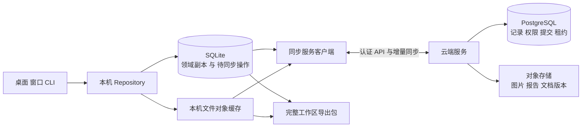

# Crew 工作区数据库与跨设备使用设计

状态：本地历史库、打开时升级、完整导出导入、动态检索和交接材料已接入应用；执行引擎仍通过旧版接口工作，数据经过迁移适配层进入新库。云端暂缓。实际接口与边界见 [实现与使用](implementation.md)。本目录 SQL 不可直接对现有 `crew.db` 执行。

本设计覆盖 Crew 的工作区、成员、聊天、任务、报告、文档、通知记录与用量，并定义完整导出、云端保存、另一台电脑接续和旧数据升级的统一规则。用户打开工作区应当取得同一份历史；更换目录、应用版本或电脑，不能产生一套没有说明的空记录。

## 架构决定

采用本地 SQLite、云端 PostgreSQL 和对象存储三部分。SQLite 保存本机可访问工作区的关系数据副本以及尚未同步的操作，保证离线查看和编辑。PostgreSQL 保存云端已经接受的状态、成员权限、同步提交和执行租约。图片、报告 HTML、文档版本及选入的产物文件，以内容摘要登记到数据库，原始字节放在本机对象缓存和云端对象存储。

本地与云端使用相同的领域模型和永久 ID，通过服务 API 同步记录及文件；不把运行中的 SQLite 文件交给网盘反复覆盖。SQLite WAL 要求访问进程处于同一主机，不适合作为多台电脑共同写入的网络文件。[SQLite WAL 文档](https://sqlite.org/wal.html)

云端记录代表已接受的共同状态。本地未上传的编辑单独标记为待同步，不伪装成已经保存到云端。未启用云端的用户仍可使用完整本地工作区；首次启用时明确将本地身份关联到所选账号，不能因为登录就给已有记录换 ID。

## 文件与结构入口

| 文件 | 职责 |
|---|---|
| `sqlite.sql` | 可导出、可同步的领域数据结构 |
| `local.sql` | 设备目录绑定、原生工具绑定、草稿、待同步操作与冲突 |
| `postgres-domain.sql` | 同一领域模型的 PostgreSQL DDL |
| `cloud.sql` | 云端权限执行、同步提交、设备水位、执行租约及对象上传状态 |
| `security.sql` | PostgreSQL 工作区读取隔离、默认拒绝和部署权限基线 |
| `data-dictionary.md` | 领域表和约束说明 |
| `sync-protocol.md` | 推送、拉取、冲突、删除、执行接管与故障恢复协议 |
| `export-format.md` | 完整导出包、导入、恢复与复制规则 |
| `legacy-mapping.md` | 现有表、JSONL 和文件的迁移归属 |
| `reference_export.py` | 只用于设计验证的合成数据导出和校验参考实现 |
| `verify_design.py` | DDL、隔离、关联完整性及导出反例验证 |
| `verify_domain_coverage.py` | 全领域表插入、版本守卫与复杂关联验证 |
| `generate_postgres.py` | 从领域结构重现 PostgreSQL DDL，避免两份模型漂移 |
| `verify_sql_contract.py` | 使用可选解析器检查 SQL、函数、外键和权限覆盖 |
| `validation.md` | 本次实际验证及尚未验证的实施边界 |

## 数据归属和身份

账号是云端数据与权限的归属范围，用户是实际操作人，设备是一个已登记客户端。工作区使用独立 UUID，名称、目录、Git remote、安装版本和设备均不充当身份。领域实体使用随机 UUID；迁移旧实体时以固定来源身份和旧主键生成可重放的 UUID。内容对象使用 SHA-256 校验字节内容。同步先后顺序使用服务端提交水位，不以 UUID 或设备时间作为同步完成证据。[UUID 标准](https://www.rfc-editor.org/rfc/rfc9562.html)

工作区内的关联同时约束 `workspace_id` 与实体 ID，数据库须拒绝把 A 工作区的报告关联到 B 的目标。显示名称允许重复；当前名字不是历史关联键。

| 数据类别 | 保存和携带规则 |
|---|---|
| 工作区、成员身份、聊天、需求、决定、人工待办、上下文与交付 | 领域数据库，支持同步与导出 |
| 文档、附件、报告及重要产物的真实内容 | 不可变文件对象，数据库保存版本、摘要、大小和归属 |
| 绝对目录、工作树路径、PID、端口、CLI native ID、安装路径 | 设备本地记录，不作为跨机事实 |
| 密钥、登录令牌、机器人 Secret | 系统或服务密钥库；数据库仅保存引用，不随工作区导出 |
| 流式 token、调试日志、可重建搜索索引与额度缓存 | 本机临时或可重建数据，有明确保留上限 |
| 云权限、成员授权、云端执行租约 | 云端控制数据；导出中的署名不是授权凭证 |

项目目录可保存只含工作区 ID 和标识版本的轻量文件，默认不提交 Git；绝对存储路径不写入该文件。写不了标识的只读目录仍使用本机已登记的身份。标识只能帮助查找，不能授予文件访问或云权限。

同一身份出现在两个仍存在的目录时，应用询问接续原工作区还是创建独立副本。独立副本取得新的工作区与实体 ID；同一工作区换位置则保留 ID，仅修改设备目录绑定。Git 克隆默认是新的工作区实例，不能仅凭相同 remote 继承私人历史。

## 数据写入和历史

业务关系表保存已经接受的事实，不引入一套与之竞争的完整事件溯源模型。所有正常写入通过 Repository。一次离线编辑在同一个本机事务中保存 proposed body、待同步操作和本地 generation；界面通过 Repository 叠加显示这些提议，不提前改写已接受领域行的云端 revision。收到完整云端提交后，领域行和下载游标在同一事务中更新。纯本地工作区由本机 authority 接受后写领域表。审计事件记录谁做了什么，同步提交日志负责可靠复制，两者不能混用。CLI、hooks、窗口和后台任务都调用同一写入服务，不再各自写数据库或 JSONL。

这样保留“云端 revision 只代表已接受版本”的含义。离线连改两次不会凭空制造两个已接受版本；服务器拒绝修改时，提议仍在，本机无需把领域 revision 倒退。导出含未同步编辑的副本时，先在暂存区物化提议并明确标记，不能把普通领域缓存误称为用户看到的全部未同步内容。

聊天消息、可见工具调用及结果、需求版本、报告、文档版本和用量观测保留稳定 ID。追加型内容的修正创建新版本或更正记录，不能悄悄改掉已经交付的原始内容。流式回复先在本机缓冲并做恢复检查点，结束后成为可同步消息；断线留下的半条回复明确标记为中断，不能冒充完整结果。不保存模型未向用户公开的内部思考。

可变记录使用 `revision` 和条件更新。两个设备都从 revision 5 修改同一需求时，第一个被接受后版本变为 6，第二个收到冲突并保留自己的草稿；不能按设备时间静默覆盖。独立新增消息可以合并，但执行命令、任务开始、验收决定和相互矛盾的需求修改必须由具体业务规则处理。

删除先形成删除标记，经过设备同步和保留期限后再清理内容。不可变内容仍支持用户删除；不可变指的是不能伪造原文，不代表永久不能删除。备份、服务日志与对象版本的清理范围和期限必须同时记录。

## 完整文件内容

文档索引和产物索引必须有可携带的内容版本，仅存 `D:\\...\\report.md` 不能满足云端保存。每次正式登记交付时，保存文档快照、SHA-256、大小、MIME、来源消息或执行、逻辑相对路径；后续修改产生新版本。相对路径仅用于另一台电脑上建议恢复位置，不允许包内路径越出用户选定目录。

同一工作区内相同内容去重。物理对象按工作区及摘要寻址，不通过知道摘要就获得其他工作区文件。服务验证上传完成、内容摘要、大小和工作区权限后，才允许公开引用。失败上传不是已经交付的文件。

默认完整导出包括结构化记录及其全部内容对象。仅记录模式必须由用户明确选择，并在包中声明不完整。导出默认排除整个 Git 工作树、庞大原始数据集和依赖缓存；需要携带源代码或数据时，将它们作为明确选择的产物快照纳入包，并展示大小。云端工作记录和代码仓库不是同一份备份。

## 打开工作区

1. 定位工作区身份，查本机记录与已登录账号下可访问的云记录。
2. 已有兼容记录直接打开；尚未下载的内容显示同步进度，不能显示成新建空项目。
3. 只发现旧格式或旧位置的历史时，展示来源、时间、成员、任务和文件数量，提供“接续历史并打开”“仅查看”“取消”。
4. 有多份分叉历史时先预览并选择。只读发现阶段不写库、不唤醒模型、不发历史通知。
5. 更新在暂存区执行，完成结构转换、文件校验和关联检查后才切换主入口。失败继续使用原记录并提供具体原因。
6. 记录属于更新格式时提示更新应用，不尝试降级写入；工作目录离线时保留历史，允许重新定位。

发现过程只查已知、登记过的数据来源和用户选定的位置，不在启动时导入整台机器上的全部历史。隔离测试环境保持独立，不扫描正式云账号或正式历史。

## 云端同步和换电脑

新电脑登录后取得有权访问的工作区列表，下载领域快照和必要文件对象。用户选择本机代码目录，重新检查工具安装和登录。查看旧报告无需原始项目目录；修改代码需要可用的代码仓库、依赖和有效执行环境。

Crew 身份可以延续，原生 Claude/Codex 会话是否可恢复取决于工具能力。原生会话归档可以作为可选、明确格式的对象保存；不兼容时创建新的原生执行，将用户可读历史、需求、决定和上下文交接给它，保留旧执行的来源。系统不能宣称复制 native ID 就能在另一台电脑恢复进程或模型内部状态。

同步不会启动任务。用户明确继续时，设备先取得云端执行租约，再检查本机环境和文件版本。云端以递增 fencing token 拒绝过期执行的写入；本机 watchdog 在租约失效时中断托管执行。已经送到外部系统或未受管理终端的副作用无法被数据库撤回，协议不能承诺绝对只执行一次。

本设计默认离线可查看历史、编辑草稿和排队可合并操作；离线不启动需要跨设备唯一执行权的模型任务。纯本地工作区可以离线执行，但它必须先声明本地独占；转为云端托管前停止执行并完成接管，不能同时宣称本地和云端各有唯一执行权。

## 云服务与访问

客户端仅访问认证 API，不直接持有 PostgreSQL 或对象存储的管理凭据。服务每次按当前账号、成员权限及工作区状态授权，不信任客户端提供的 `user_id` 或 `device_id`。下载地址是短期、受限对象授权；成员权限撤销后拒绝新访问。已经下载到离线设备上的内容不能远程保证抹除。

数据库使用权限最小化的服务角色和工作区行访问规则作为第二层约束。行访问策略并非默认启用，表所有者和绕过策略的角色还有特殊行为，部署时必须验证实际角色权限。[PostgreSQL 行安全文档](https://www.postgresql.org/docs/current/ddl-rowsecurity.html)

传输使用 TLS，服务数据库和对象使用静态加密，密钥与业务记录分开管理。当前方案是可信云服务模式，服务端可以处理获授权的明文，不声称端到端零知识加密。若后续要求服务运营方也不能读内容，需要另设计客户端密钥、设备恢复和查询能力，不能只在字段上加一个 `encrypted` 标记。

用户可不开启云同步；云端存储服务提供者不写死在数据库模型里。订阅、配额与计费接入属于云服务实现，不影响工作区 ID 和导出格式。

## 版本与迁移

应用版本、领域 schema 版本、同步协议版本、导出包版本分别管理。每个格式声明最低读、写版本。未知更新格式只读或拒绝，不执行旧程序的自动建表逻辑。

旧库来源登记独立 `legacy_origin_id`，来源库路径和快照摘要只是定位与校验数据；它们不参与实体 ID 生成。固定来源身份、实体类型和旧主键决定稳定映射，保证追加迁移或搬目录后仍识别同一条记录。无法证明同源的副本不能自动合并。

旧全局库的完整原始快照只进本机或账号私有的迁移保存区，不能作为某个工作区的附件随包导出。每个工作区只保留经过归属校验的旧记录切片、对应原日志和文件；无法确定归属的内容先进入隔离恢复区，防止导出一个项目时夹带其他项目和账号配置。

迁移顺序为：只读盘点 → 来源快照与完整文件清单 → 暂存新库 → 身份映射 → 内容入对象存储 → 业务与数量校验 → 切换入口 → 保留旧快照与回执。不可映射的历史保留原始归档和具体原因，不能用“兼容失败”删除。迁移本身不恢复执行权、不发送历史通知。

旧入口必须改为连接已切换的数据，或明确拒绝写入；不识别迁移标记的旧二进制需要实际写入保护和兼容测试。仅放一个“已迁移”文件不够。来源发生后续变化时显示分叉，不能凭导入收据直接忽略。

## 验收与实施顺序

设计验证命令：`python docs/storage-v2/verify_design.py`。它仅运行合成夹具，不连接正式数据库或云服务。PostgreSQL 若没有实际启动验证，必须在交付中明确写出；DDL 文件存在不代表云同步已经上线。

必须通过的产品验收包括：

- 同一工作区经应用升级、重启、更改显示名或搬目录后仍能看到原 leader、聊天、目标和交付。
- 两个工作区有同名成员和相同旧整数 ID，导出及导入均不串数据。
- 导出含附件和真实产物内容，在没有原始 D 盘目录的新电脑仍可查看报告与文档。
- 导入包缺失对象、摘要错误、路径越界、版本过新时失败，现有工作区保持可用。
- 两台设备离线修改同一需求时形成可处理冲突；重试同一操作不重复新增消息或执行。
- 拉取分页、进程中断、对象上传中断后可以重试；不跳过尚未完整提交的记录。
- 删除后旧设备回连不会复活记录；未知离线新设备拿旧备份只能先只读查看或明确创建副本。
- 同时点击继续执行时仅一个设备取得有效租约；旧设备过期后的写入被拒绝。
- 旧库升级中断可以恢复，source 后续变化会被发现，升级不会触发无关模型或远程通知。

实施按可验证边界推进：先建立新 Repository 与 schema 版本机制，再导入旧数据并接通打开流程；随后完成完整导出导入；最后接入云端同步、对象传输和设备执行接管。每一步都必须能独立回归，不能一次性替换正式数据后再补完整性检查。
